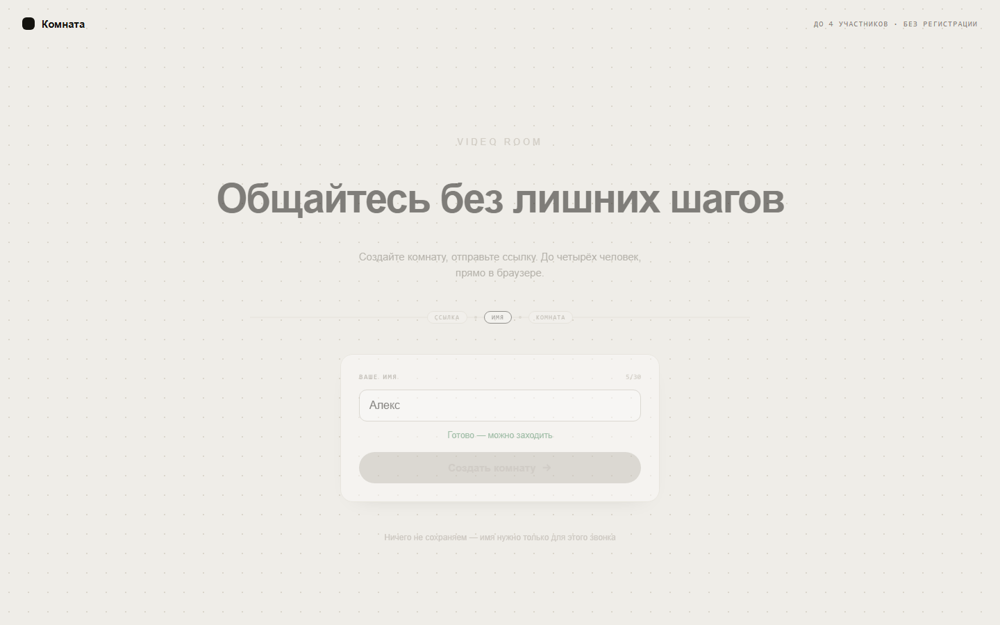
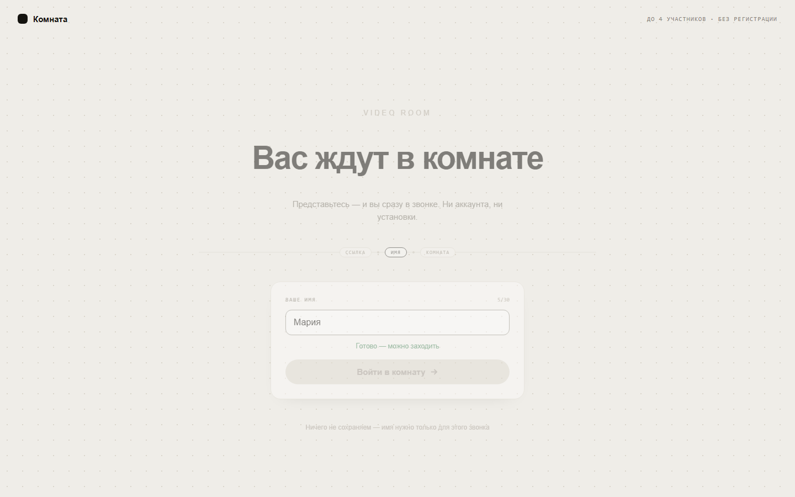
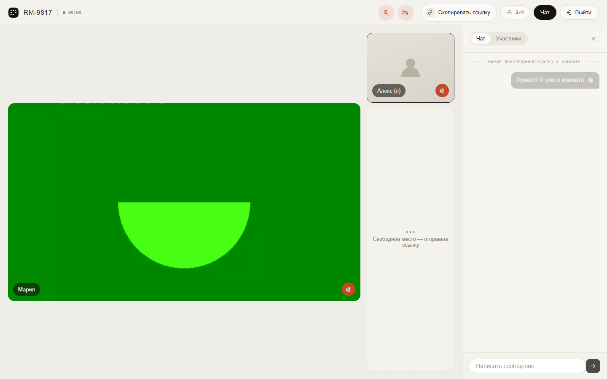

# Комната

Видеозвонки до четырёх участников прямо в браузере — без регистрации и установки приложений.



## Возможности

- Комната создаётся одной кнопкой, приглашение отправляется ссылкой.
- Камера и микрофон по умолчанию выключены и управляются независимо.
- Есть текстовый чат, список участников и состояния устройств.
- Активный звонок восстанавливается после обновления страницы.
- До четырёх участников в одной P2P WebRTC-комнате.

## Пользовательский флоу

1. Введите имя и создайте комнату.
2. Отправьте ссылку собеседнику — ему останется только представиться.

   

3. Общайтесь по видео или голосом и используйте чат.

   

## Быстрый запуск

Нужны Node.js 20+ и npm.

```bash
npm install
npm run dev
```

Откройте [http://127.0.0.1:5173](http://127.0.0.1:5173).

```bash
npm test          # unit и integration
npm run test:e2e  # пользовательские сценарии Playwright
npm run lint
npm run build
```

## Стек

React + Vite на клиенте, Express + Socket.io на сервере, WebRTC P2P для медиа. Состояние комнат хранится в памяти, поэтому текущая версия рассчитана на один серверный процесс.

Скриншоты можно обновить на запущенном проекте:

```bash
node scripts/capture-readme-screenshots.mjs
```

Подробные PRD, технический дизайн и план реализации находятся в [`prds/video-chat-room`](prds/video-chat-room).
