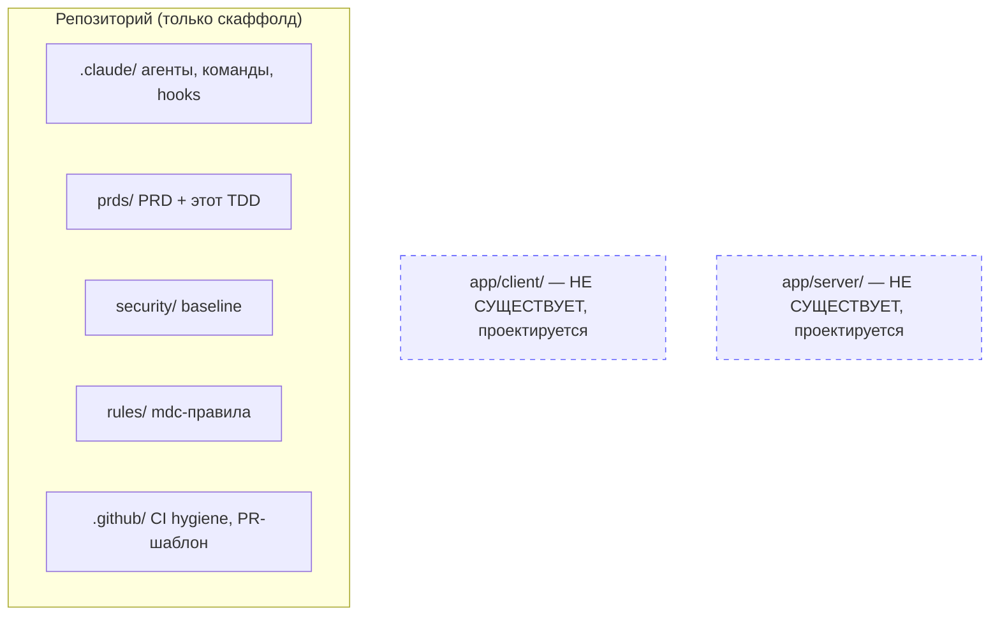
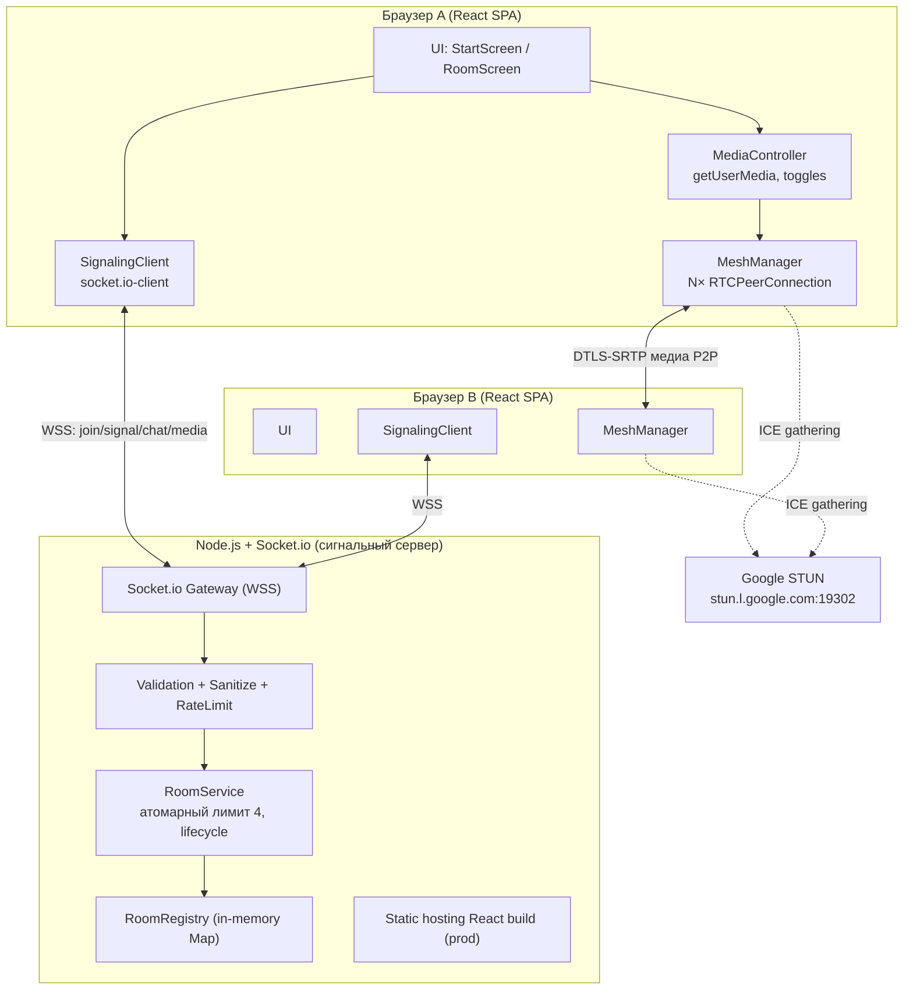
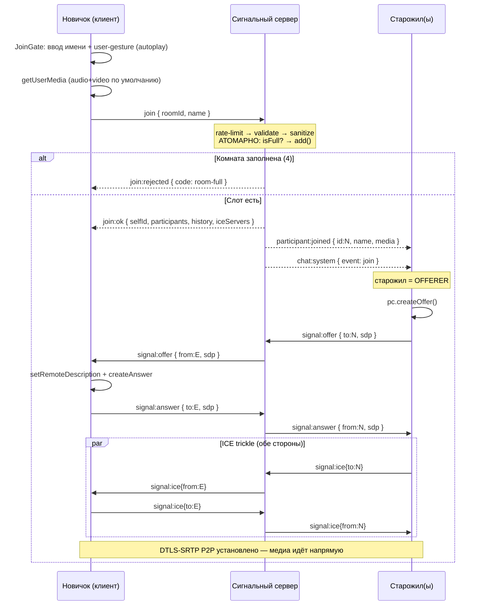
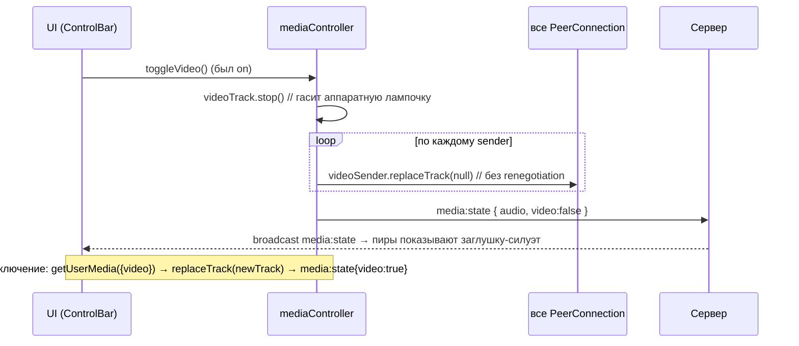
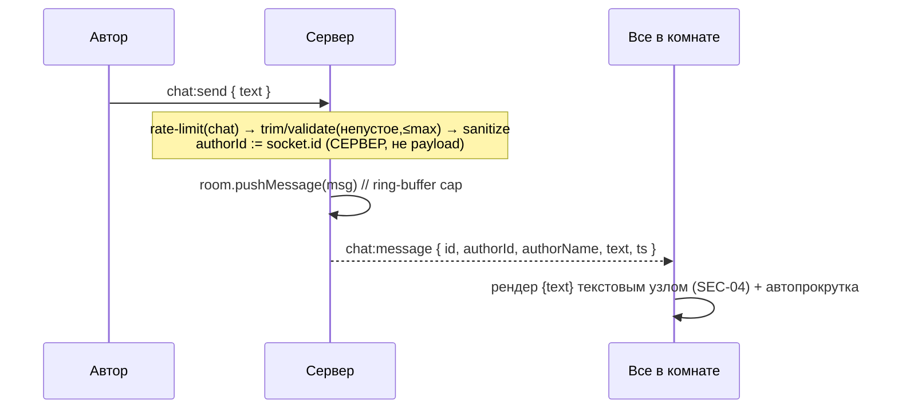
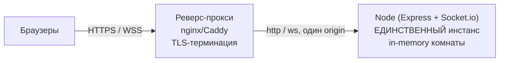

# Technical Design Document (TDD) — Видеочат-комната (`video-chat-room`)

| | |
|---|---|
| **Документ** | Technical Design Document (TDD) |
| **Версия** | 1.1 |
| **Стадия пайплайна** | Дизайн (`/design`) |
| **feature-name** | `video-chat-room` |
| **Источник требований** | `prds/video-chat-room/prd-video-chat-room.md` (PRD v1.0) — F-01..F-40, US-1..US-13 |
| **Security-источник** | `security/security-baseline.md` (v1.0) — чек-лист SEC-01..SEC-21 |
| **Правила оформления** | `rules/prd-design.mdc` |
| **Статус кодовой базы** | **Greenfield** (production-кода нет; см. §2) |

> Документ описывает **КАК** реализовать фичу. Он не содержит production-кода — только контракты, схемы, диаграммы и примеры структур в блоках кода. Все решения трассируются к ID требований PRD и пунктам SEC-чек-листа.
>
> Зафиксированные архитектурные рамки (PRD §7) — **не пересматриваются**: WebRTC mesh P2P (≤4), Node.js + Socket.io сигналинг, публичные Google STUN без TURN, состояние в памяти без БД, стек JS/React/Socket.io/WebRTC, русский UI.

### История изменений
| Версия | Дата | Изменения |
|---|---|---|
| 1.0 | 2026-07-24 | Первая редакция TDD по PRD v1.0 и security-baseline v1.0. |
| 1.1 | 2026-07-24 | Закрыты открытые вопросы v1.0 по решениям продуктовой команды: (1) TLS/WSS терминируется реверс-прокси, модель single-origin за прокси зафиксирована в SEC-12/13/15; (2) числовые лимиты приняты как константы конфигурации (§9.3); (3) тулинг зафиксирован — Vite + Vitest + Playwright + Express (§3.2, §11, §12); (4) autoplay-fallback подтверждён; (5) single-instance зафиксирован как явное ограничение развёртывания (§9.2, §12, §13). Раздел «Open Questions» сокращён до неустранимого (конкретный прод-домен — при деплое). |
| 1.1a | 2026-07-28 | **Архитектура/протокол/безопасность не пересматриваются.** Добавлена ссылка на `design-ui-video-chat-room.md` (UI Design Addendum) — после закрытия задач 1–33 (функционал готов, но без единого CSS-файла) утверждён hi-fi визуальный дизайн (Claude Design, композиция «1c Говорящий крупно»); аддендум описывает архитектуру стилизации (CSS Modules, design-токены), gap-анализ компонент → экран и план задач 34–44 (`impl-video-chat-room.md`, область 10). Компоненты §4.2 этой TDD (`VideoGrid`/`ControlBar`/`ChatPanel`/`ParticipantList` и др.) частично реструктурируются на уровне композиции UI — их серверные контракты §6 не меняются. |

---

## 1. Overview / Контекст

### 1.1 Цель фичи
Веб-приложение группового видеозвонка **до 4 участников** с общим текстовым чатом, работающее в браузере без регистрации: «зашёл по ссылке → представился → общаешься». Медиа (видео/аудио) идёт напрямую между браузерами по WebRTC (mesh P2P) и шифруется DTLS-SRTP; сигналинг, текстовый чат и системные события проходят через Node.js + Socket.io; состояние комнат/участников/истории чата живёт только в памяти сервера.

### 1.2 Ссылка на PRD и объём
- PRD: `prds/video-chat-room/prd-video-chat-room.md` (v1.0).
- В объёме: US-1..US-13, F-01..F-40.
- Вне объёма (PRD §5, зафиксировано): authN/authZ, приватность/лобби комнат, TURN, E2E сверх DTLS-SRTP, персистентность (БД/localStorage), auto-reconnect, роли модератора, screen-share/запись, i18n, мобильная адаптация, >4 участников. Эти пункты в TDD трактуются как `accepted-risk`/`n/a`, а не как задачи.

### 1.3 Ключевые ограничения (жёсткие рамки)
| Ограничение | Источник | Следствие для дизайна |
|---|---|---|
| Топология медиа — mesh P2P, ≤4 | PRD §7, F-05 | N·(N−1)/2 соединений (макс. 6/комнату, 3 исходящих потока/клиент); лимит 4 — жёсткий, проверяется атомарно на сервере |
| Сигналинг/чат — Node.js + Socket.io | PRD §7 | Единый WSS-транспорт; сервер — единственный контроль лимита и источник истории чата |
| ICE — публичные Google STUN, без TURN | PRD §7, F-34 | Строгий NAT → недостижимость пары допустима (graceful-деградация) |
| Состояние — в памяти сервера | PRD §7, F-09 | Нет БД/миграций; жизненный цикл комнаты = защита данных и памяти |
| HTTPS/WSS обязателен | PRD §7, SEC-12 | `getUserMedia`/WebRTC работают только в secure context |
| Десктоп ≥1024px, Chrome/Firefox/Edge 100+ | PRD §2, §7 | Нет mobile-first; явная проверка поддержки WebRTC |
| UI на русском, без i18n | PRD §6 | Строки хардкодятся на русском |

---

## 2. Current Architecture & Codebase Summary

### 2.1 Статус: Greenfield
**Production-кода в репозитории нет.** Репозиторий содержит только агентный скаффолд spec-driven пайплайна. Сводка просмотренных файлов:

| Путь | Назначение | Влияние на TDD |
|---|---|---|
| `prds/video-chat-room/prd-video-chat-room.md` | PRD v1.0 — источник F-/US- требований | Все требования дизайна трассируются сюда |
| `security/security-baseline.md` | Threat model + чек-лист SEC-01..SEC-21 | §10 TDD построен на нём |
| `rules/prd-design.mdc` | Структура и правила TDD | Определяет 14 разделов документа |
| `rules/prd-tasks.mdc` | Правила Implementation Plan | Вход для следующей стадии (`/plan`) |
| `.github/workflows/ci.yml` | CI-гейт `hygiene` (валидация settings.json, синтаксис хука, маркеры конфликтов) | Джобы `lint`/`test` — заготовки; их надо наполнить под выбранный стек (см. §12) |
| `.github/CODEOWNERS`, `pull_request_template.md` | Правила ревью и шаблон PR | PR ссылается на SEC-пункты и задачу плана |
| `.claude/hooks/pre-merge-gate.js` | Гейт security-review перед мержем | Требует маркер `.gates/security-<HEAD>.ok` |
| `.claude/agents/*`, `.claude/commands/*` | Определения агентов/команд пайплайна | Организационный контекст, не код фичи |

**Вывод:** структура клиента и сервера проектируется с нуля (см. §3.2). Нет унаследованных контроллеров, сервисов, схем БД или тестов, которые надо учитывать или мигрировать. Раздел «Data Model & DB Changes» (§5) сводится к in-memory моделям; «Migration Plan» (§12) — только начальная инициализация проекта.

### 2.2 Диаграмма текущего состояния


---

## 3. Proposed Architecture / High-Level Design

### 3.1 Компонентная схема


**Плоскости:**
- **Плоскость сигналинга/чата (через сервер):** установка соединения (SDP offer/answer, ICE), текстовый чат, системные события, статусы медиа, контроль лимита. Транспорт — WSS (Socket.io). Сервер видит эти данные открытым текстом (§4 baseline).
- **Плоскость медиа (P2P, минуя сервер):** аудио/видео между браузерами напрямую, DTLS-SRTP. Сервер медиа не видит.

### 3.2 Структура проекта (монорепо, npm workspaces)
```
video-chat-room/
├── package.json                # workspaces: ["app/server","app/client"], скрипты dev/build/test/lint/audit
├── package-lock.json           # зафиксирован (SEC-19)
├── .nvmrc                      # Node LTS (20.x)
└── app/                        # кодовая база приложения (отделена от prds/, security/, rules/, .claude/, .github/)
    ├── server/
    │   ├── package.json
    │   └── src/
    │       ├── index.js            # точка входа: Express (http) + Socket.io + (prod) статика app/client/dist
    │       ├── config.js           # ЕДИНЫЙ источник конфигурации/лимитов (см. §9.3)
    │       ├── logger.js           # обезличенное логирование (SEC-16)
    │       ├── security/
    │       │   └── headers.js      # secure-заголовки + CSP (SEC-13)
    │       ├── socket/
    │       │   ├── gateway.js      # io init, maxHttpBufferSize, CORS/origin (SEC-08,15)
    │       │   └── handlers.js     # обработчики событий (join/signal/chat/media/leave/disconnect)
    │       ├── domain/
    │       │   ├── Room.js         # сущность комнаты (участники, история, счётчик)
    │       │   ├── Participant.js  # сущность участника
    │       │   ├── Message.js      # сущность сообщения (chat/system)
    │       │   └── RoomRegistry.js # Map<roomId,Room>; create/get/cleanup; caps (SEC-10,11)
    │       ├── services/
    │       │   └── RoomService.js  # атомарный join/leave, lifecycle, broadcast-хелперы (SEC-07,11)
    │       └── lib/
    │           ├── validate.js     # серверная валидация имени/текста (SEC-01,02,03)
    │           ├── sanitize.js     # нейтрализация контента (SEC-03)
    │           └── rateLimit.js    # token-bucket на соединение (SEC-05)
    └── client/
        ├── package.json
        ├── index.html
        ├── vite.config.js
        └── src/
            ├── main.jsx            # bootstrap React
            ├── App.jsx             # роутинг Start ↔ Room, глобальные ошибки окружения
            ├── config.js           # ICE-серверы (STUN), URL сигналинга (SEC-17)
            ├── screens/
            │   ├── StartScreen.jsx # ввод имени, «Создать комнату» (US-1,2)
            │   └── RoomScreen.jsx  # видеосетка + панель управления + чат (US-6..10)
            ├── components/
            │   ├── VideoGrid.jsx   # адаптивная сетка 1–4 плитки (F-07)
            │   ├── VideoTile.jsx   # self/remote плитка: видео|заглушка, оверлей имени, mic-off (F-08,16,18)
            │   ├── ControlBar.jsx  # тумблеры mic/cam, «Выйти», «копировать ссылку» (F-03,09,10,17)
            │   ├── ChatPanel.jsx   # список сообщений + автопрокрутка + ввод (US-8, F-12..15)
            │   ├── ParticipantList.jsx # актуальный список (F-16)
            │   ├── JoinGate.jsx    # запрос имени при входе по ссылке + user-gesture (autoplay, F-37)
            │   └── errors/         # RoomFull, DeviceDenied, ServerDown, NoWebRTC баннеры (US-12,13)
            ├── webrtc/
            │   ├── MeshManager.js  # управление N соединениями, glare-free инициатива
            │   └── PeerConnection.js # обёртка одного RTCPeerConnection
            ├── media/
            │   └── mediaController.js # getUserMedia, toggle mic (enabled), toggle cam (stop+replaceTrack) (F-19)
            ├── socket/
            │   └── signalingClient.js # обёртка socket.io-client, типобезопасные emit/on
            ├── hooks/
            │   ├── useSignaling.js
            │   ├── useMesh.js
            │   └── useMedia.js
            └── lib/
                ├── escape.js       # клиентская нейтрализация (defense-in-depth; рендер через {value})
                └── compat.js       # детект поддержки WebRTC/getUserMedia (F-36)

Тесты — в каждом workspace: app/server/tests, app/client/tests, app/e2e/ (Playwright).
```

**Обоснование монорепо:** один `package-lock.json` (SEC-19), общий CI-гейт `hygiene` + будущие `lint`/`test`, простое совместное версионирование клиента и протокола. В проде Node-сервер отдаёт статическую сборку клиента с того же origin (упрощает CORS/CSP — SEC-13,15).

**Зафиксированный тулинг (v1.1):**
- **Клиент:** Vite (dev-сервер + `vite build` → `app/client/dist`), React 18, `socket.io-client`.
- **Сервер:** Node.js 20 LTS, **Express** (http-сервер под Socket.io + раздача статики `app/client/dist` в проде + `/healthz`), `socket.io`.
- **Тесты:** **Vitest** (unit — сервер и клиент), **Playwright** (e2e, многопользовательские WebRTC-сценарии с fake-media).
- **Реверс-прокси (прод):** nginx/Caddy перед Node — терминирует HTTPS/WSS; статика + Socket.io проксируются с одного origin (см. §10 SEC-12, §12).

### 3.3 Ключевые архитектурные решения (résumé)
1. **Directional mesh, glare-free.** При входе нового участника **оферы создают уже присутствующие участники** (offerer = «старожил»), новичок только отвечает. Каждой паре соответствует ровно один инициатор → glare (встречные оферы) исключён без «perfect negotiation».
2. **Камера off = release устройства без renegotiation.** `track.stop()` (гасит аппаратный индикатор, F-19) + `sender.replaceTrack(null)` на всех PeerConnection. m-line сохраняется → renegotiation не нужен. Статус транслируется явным событием `media:state`, чтобы пиры показали заглушку/иконку.
3. **Сервер — единственный источник истины по составу, лимиту и истории.** Клиент не доверяет клиенту; авторство и внутренний ID проставляет сервер по socket-id (SEC-06).
4. **Всё эфемерно.** Нет БД, нет localStorage. Комната удаляется при счётчике 0 (F-09) — это и приватность, и защита памяти (SEC-11).

---

## 4. Components & Interfaces

### 4.1 Сервер

| Компонент | Ответственность | Ключевой интерфейс (концептуально) |
|---|---|---|
| `socket/gateway.js` | Инициализация Socket.io поверх http-сервера; `maxHttpBufferSize`, CORS/origin allow-list, WSS. Регистрация `handlers`. | `createGateway(httpServer, config) -> io` |
| `socket/handlers.js` | Приём событий сокета, вызов валидации/rate-limit, делегирование в `RoomService`, эмиссия ответов. Никакой бизнес-логики лимита внутри. | on: `join`, `signal:offer/answer/ice`, `chat:send`, `media:state`, `leave`, `disconnect` |
| `services/RoomService.js` | **Атомарные** join/leave; lifecycle комнаты; формирование payload; broadcast. | `join(socket,{roomId,name}) -> {ok, selfId, snapshot} \| {ok:false, code}`; `leave(socket)`; `relaySignal(...)`; `postChat(...)`; `setMedia(...)` |
| `domain/RoomRegistry.js` | Map комнат; создание по требованию; очистка пустых; caps на число комнат. | `getOrCreate(roomId)`, `get(roomId)`, `delete(roomId)`, `count()` |
| `domain/Room.js` | Инкапсуляция участников (Map<socketId,Participant>), истории (ring-buffer), счётчика. | `add(p)`, `remove(id)`, `size()`, `isFull()`, `pushMessage(m)`, `snapshot()` |
| `lib/validate.js` | Серверная валидация имени (≤30, allow-list символов, непустое после trim) и текста (непустой после trim, ≤ maxLen). | `validateName(raw)->{ok,value\|code}`, `validateText(raw)->{ok,value\|code}` |
| `lib/sanitize.js` | Нейтрализация контента перед хранением/ретрансляцией (экранирование/удаление опасных символов). | `sanitize(str)->str` |
| `lib/rateLimit.js` | Token-bucket на соединение по категориям (chat, signal, join). | `allow(socketId, category)->bool` |

**Инвариант атомарности лимита (SEC-07):** `RoomService.join` выполняется как единый синхронный участок event-loop — проверка `room.isFull()` и `room.add()` не разделены `await`. Node.js однопоточен, поэтому синхронная секция «check → reserve» атомарна по отношению к другим join. Это закрывает гонку US-5.

### 4.2 Клиент

| Компонент | Ответственность | Интерфейс |
|---|---|---|
| `App.jsx` | Маршрут Start/Room по URL; preflight-проверка окружения (WebRTC/secure context, F-36); отображение фатальных баннеров. | — |
| `StartScreen.jsx` | Ввод имени (клиентская валидация — UX), «Создать комнату» → генерирует roomId и переходит на `/room/:id`. | props: `onCreate(name)` |
| `RoomScreen.jsx` | Оркестрация: media → mesh → signaling; раскладка (VideoGrid + ControlBar + ChatPanel + ParticipantList). | — |
| `JoinGate.jsx` | Экран запроса имени при входе по ссылке; **кнопка входа = user-gesture** для autoplay (F-37); первичный `getUserMedia`. | `onJoin(name)` |
| `mediaController.js` | `getUserMedia`; toggle mic (`track.enabled`); toggle cam (`stop()`+`replaceTrack`); обработка отказа/отсутствия устройств (US-12, F-14). | `init()`, `toggleAudio()`, `toggleVideo()`, `getLocalStream()` |
| `MeshManager.js` | Реестр `PeerConnection` по peerId; создаёт/закрывает соединения по событиям состава; маршрутизирует сигналинг; агрегирует remote-streams. | `onParticipantJoined(id)`, `onParticipantLeft(id)`, `handleSignal(msg)`, `attachLocalTrack(track)` |
| `PeerConnection.js` | Обёртка одного `RTCPeerConnection`: создание offer/answer, ICE, `ontrack`, `replaceTrack`, close. | `createOffer()`, `acceptOffer(sdp)`, `acceptAnswer(sdp)`, `addIce(c)`, `close()` |
| `signalingClient.js` | socket.io-client: connect(WSS), emit/on обёртки, реэмиссия ошибок соединения (US-13 «сервер недоступен»). | `connect()`, `emit(event,payload)`, `on(event,cb)`, `onError(cb)` |
| `VideoTile.jsx` | Рендер видео **или** заглушки-силуэта с именем; оверлей имени (экранированный `{name}`); иконка mic-off. | props: `participant, stream, mediaState, isSelf` |
| `ChatPanel.jsx` | Рендер истории (текстовыми узлами `{text}` — SEC-04), автопрокрутка, ввод, запрет пустых. | — |

---

## 5. Data Model & DB Changes

**БД нет** (PRD §7). Модель данных — **in-memory на сервере**; миграций и индексов нет. Ниже — концептуальные структуры (JS-объекты), не SQL.

### 5.1 Сущности (сервер, RAM)
```text
RoomRegistry
  rooms: Map<roomId: string, Room>

Room
  id:        string        // roomId (crypto.randomUUID) — SEC-14
  participants: Map<socketId: string, Participant>
  history:   Message[]     // ring-buffer, cap = HISTORY_MAX (SEC-09)
  createdAt: number        // ms

Participant
  id:        string        // = socket.id (внутренний, в UI не показывается) — A-6, SEC-06
  name:      string        // валидированное+санитизированное имя, ≤30 — SEC-01,03
  media:     { audio: boolean, video: boolean }   // текущее состояние тумблеров
  joinedAt:  number

Message  (discriminated union)
  id:        string        // серверный uuid сообщения
  kind:      'chat' | 'system'
  ts:        number        // серверное время (ms); формат HH:MM считает клиент по локали (F-13)
  // kind === 'chat':
  authorId:  string        // = socketId автора, проставлен СЕРВЕРОМ — SEC-06
  authorName:string        // снимок имени автора на момент отправки
  text:      string        // валидирован+санитизирован — SEC-02,03
  // kind === 'system':
  event:     'join' | 'leave'
  subjectName: string
```

### 5.2 Жизненный цикл и инварианты
| Инвариант | Реализация | Требование |
|---|---|---|
| Комната создаётся при первом участнике (в т.ч. по URL) | `RoomRegistry.getOrCreate` в `join` | F-05, US-4 |
| ≤ 4 участника | `Room.isFull()` в атомарной секции join | F-05/07, SEC-07 |
| Комната + история удаляются при size()==0 | `RoomService.leave`/`disconnect` → `RoomRegistry.delete` | F-09, US-10, SEC-11 |
| История ограничена | `Room.pushMessage` вытесняет старейшее при > HISTORY_MAX | SEC-09 |
| Внутренний ID = socket.id, уникален, в UI скрыт | сервер, не клиент | F-30, SEC-06 |
| Число комнат ограничено | `RoomRegistry` cap ROOMS_MAX | SEC-10 |

### 5.3 Состояние клиента (только RAM вкладки)
Нет `localStorage`/`sessionStorage`/cookies (PRD §5). Всё в React-state: `selfId`, `participants[]`, `messages[]`, `localStream`, `mediaState`, `peers`. Перезагрузка = новый вход (F-28).

---

## 6. API / Contracts — протокол сигналинга (Socket.io / WSS)

Единственный сетевой контракт приложения — события Socket.io. REST/HTTP используется только для отдачи статики и (опц.) health-check. Транспорт — WSS (SEC-12). Все payload от клиента — **недоверенный ввод** (TB-1), проходят валидацию/rate-limit до обработки.

### 6.1 Client → Server

| Событие | Payload | Обработка на сервере | Требование |
|---|---|---|---|
| `join` | `{ roomId: string, name: string }` | rate-limit(join) → `validateName` → `sanitize` → атомарный `RoomService.join`. Ответ `join:ok` **или** `join:rejected`. | F-01/04/05, US-4/5, SEC-01/03/07 |
| `chat:send` | `{ text: string }` | rate-limit(chat) → `validateText` → `sanitize` → построить `Message(kind:chat, authorId=socket.id)` → push в историю → broadcast `chat:message`. | F-12/24, US-8, SEC-02/03/05/06 |
| `media:state` | `{ audio: boolean, video: boolean }` | rate-limit(signal) → обновить `participant.media` → broadcast `media:state`. | F-09/16/18, US-7/12 |
| `signal:offer` | `{ to: socketId, sdp: string }` | rate-limit(signal) → проверить, что `to` в той же комнате → relay `signal:offer{from,sdp}` только адресату. | F-06, US-6 |
| `signal:answer` | `{ to: socketId, sdp: string }` | как offer → relay `signal:answer{from,sdp}`. | F-06 |
| `signal:ice` | `{ to: socketId, candidate: object }` | как offer → relay `signal:ice{from,candidate}`. | F-06, SEC-18 |
| `leave` | `{}` | `RoomService.leave` (эквивалент disconnect). | F-17, US-10 |
| (транспорт) `disconnect` | — | Socket.io системное; `RoomService.leave` + cleanup. | F-18, US-10/11, SEC-11 |

> Сервер **не парсит SDP** — ретранслирует строку как есть только адресату `to` внутри той же комнаты (SEC-18). Валидируется лишь принадлежность `to` комнате и размер payload (SEC-08).

### 6.2 Server → Client

| Событие | Payload | Смысл | Требование |
|---|---|---|---|
| `join:ok` | `{ selfId, participants: [{id,name,media}], history: Message[], iceServers }` | Успешный вход: снимок состояния + свой ID + история чата (поздний вход видит переписку) + ICE-конфиг. | F-14/16, US-4/8, SEC-17 |
| `join:rejected` | `{ code: 'room-full' \| 'invalid-name', message }` | Отказ входа (5-й участник → `room-full`). | F-05, US-5, SEC-07 |
| `participant:joined` | `{ id, name, media }` | Новый участник вошёл (сигнал старожилам создать offer к нему). | F-16, US-6/9 |
| `participant:left` | `{ id }` | Участник вышел/оборвался (закрыть PeerConnection, убрать плитку). | F-17/18, US-9/10/11 |
| `chat:message` | `{ id, authorId, authorName, text, ts }` | Новое чат-сообщение всем в комнате. | F-12/13, US-8 |
| `chat:system` | `{ id, event:'join'\|'leave', subjectName, ts }` | Системное сообщение о входе/выходе. | F-15, US-9 |
| `media:state` | `{ id, audio, video }` | Изменение статуса mic/cam участника. | F-16/18, US-7/12 |
| `signal:offer` | `{ from: socketId, sdp }` | Входящий offer от пира. | F-06 |
| `signal:answer` | `{ from: socketId, sdp }` | Входящий answer. | F-06 |
| `signal:ice` | `{ from: socketId, candidate }` | Входящий ICE-кандидат. | F-06 |
| `error` | `{ code, message }` | Обобщённая ошибка (rate-limit exceeded, bad-payload) — без внутренних деталей. | SEC-15 |

### 6.3 Пример потока payload (JSON)
```jsonc
// C→S
{ "event": "join", "data": { "roomId": "b1f2...uuid", "name": "Алекс" } }
// S→C (инициатору)
{ "event": "join:ok",
  "data": {
    "selfId": "sock_AbC123",
    "participants": [ { "id": "sock_AbC123", "name": "Алекс", "media": { "audio": true, "video": true } } ],
    "history": [],
    "iceServers": [ { "urls": "stun:stun.l.google.com:19302" } ]
  } }
// S→C (остальным в комнате)
{ "event": "participant:joined",
  "data": { "id": "sock_AbC123", "name": "Алекс", "media": { "audio": true, "video": true } } }
```

### 6.4 URL-контракт (клиент)
- `/` — StartScreen (создание комнаты).
- `/room/:roomId` — вход в комнату; `roomId` считывается из URL (F-04). Несуществующий `roomId` → сервер создаёт комнату (F-05, US-4). Создание комнаты на StartScreen генерирует `roomId = crypto.randomUUID()` (SEC-14) и делает `navigate(/room/:roomId)`.

---

## 7. Data & Control Flows

### 7.1 Вход и установка mesh (glare-free)

**Правило инициативы:** offerer — участник, который уже был в комнате на момент `participant:joined`. Новичок при получении `join:ok` НЕ инициирует оферы (он их ждёт). Так на пару приходится ровно один offer.

### 7.2 Выключение камеры (F-19, release устройства)


### 7.3 Выход / обрыв / удаление комнаты
```mermaid
sequenceDiagram
    participant X as Участник
    participant S as Сервер
    participant R as Остальные
    alt Явный выход / закрытие вкладки
        X->>S: leave (или transport disconnect)
    else Обрыв соединения
        Note over S: Socket.io disconnect (heartbeat timeout)
    end
    S->>S: RoomService.leave: room.remove(id)
    S-->>R: participant:left { id }
    S-->>R: chat:system { event: leave, subjectName }
    R->>R: pc[id].close(); убрать плитку
    alt room.size() == 0
        S->>S: RoomRegistry.delete(roomId) — история чата стёрта (SEC-11)
    end
```
> Формулировку «соединение потеряно» не используем — сервер не отличает обрыв от выхода (F-18). Auto-reconnect отсутствует (PRD §5); возврат — вручную повторным входом.

### 7.4 Отправка чат-сообщения


---

## 8. Error Handling & Edge Cases

Полное покрытие крайних случаев PRD (US-11..13 и др.).

| Кейс | Сторона | Поведение | Требование |
|---|---|---|---|
| **Пустое/пробельное имя** | Клиент (UX) + Сервер (истина) | Клиент блокирует кнопку + подсказка; сервер отклоняет `join` (`invalid-name`). | F-01/38, US-1, SEC-01 |
| **Имя >30 / спецсимволы** | Клиент + Сервер | Клиент обрезает до 30 и фильтрует ввод; сервер повторно валидирует по allow-list, спецсимволы экранируются/отклоняются. | F-38, US-1, SEC-01/03 |
| **Одинаковые имена** | Сервер | Разрешено; различение по socket.id (в UI не видно). | F-30, US-1 |
| **Комната заполнена (5-й)** | Сервер → Клиент | `join:rejected{room-full}` → баннер «Комната заполнена» + кнопка «Повторить вход». | F-05, US-5, SEC-07 |
| **Гонка за последний слот** | Сервер | Атомарная секция check→add; проигравший получает `room-full`. | F-05, US-5, SEC-07 |
| **Несуществующий roomId в URL** | Сервер | Создаётся новая комната, вход как первый участник (нет состояния «не найдено»). | F-05, US-4 |
| **Отказ в доступе к камере/микрофону** | Клиент | `getUserMedia` reject → остаётся в комнате с выключенными устройствами; баннер «нет доступа»; `media:state{false}`. Не «вылетает». | F-33, US-12, SEC-21 |
| **Нет физических устройств** | Клиент | Присоединяется; отсутствующее устройство = off; заглушка/mic-off у других. | F-14, US-6/12 |
| **Потеря устройства во время звонка** | Клиент | `track.onended` / `devicechange` → поток прекращается, `media:state{false}`; восстановление через настройки ОС/браузера (ре-`getUserMedia`). | F-20, US-7 |
| **Обрыв соединения (сокет)** | Сервер | disconnect → участник удалён, слот освобождён, `participant:left` + `chat:system(leave)`; остальные продолжают. | F-18, US-11, SEC-11 |
| **Несколько вкладок одного юзера** | Сервер | Каждая вкладка = отдельный socket = отдельный участник/слот. | F-29, US-11 |
| **Autoplay заблокирован** | Клиент | Вход = user-gesture; remote `<audio autoplay>` играет после жеста; fallback-кнопка «Включить звук» при `play()` reject. | F-37, US-13 |
| **Браузер без WebRTC** | Клиент (preflight) | `compat.js` детект `RTCPeerConnection`/`getUserMedia` → экран «WebRTC не поддерживается», приложение не грузит комнату. | F-36, US-13 |
| **Сигнальный сервер недоступен** | Клиент | `connect_error`/timeout socket.io → баннер «Ошибка сервера»; без белого экрана. | F-35, US-13 |
| **STUN недоступен / P2P не встал** | Клиент | ICE fail для пары → плитка без медиа/индикация; приложение работает (чат, другие пиры). Graceful. | F-34, US-13, SEC-17 |
| **Некорректный/вредоносный SDP/ICE от пира** | Клиент | `setRemoteDescription`/`addIceCandidate` в try/catch; ошибка не роняет клиент; свой парсинг SDP отсутствует. | SEC-18, TB-3 |
| **Rate-limit превышен** | Сервер | Троттлинг/отклонение события + `error{code:rate-limited}`; сервер не падает. | F-40, SEC-05 |
| **Гигантский payload** | Сервер | `maxHttpBufferSize` рвёт фрейм до обработки; длина имени/текста валидируется. | SEC-08 |

**Коды ошибок клиенту (обобщённые, SEC-15):** `room-full`, `invalid-name`, `rate-limited`, `bad-payload`, `server-unavailable`, `webrtc-unsupported`, `media-denied`. Без стек-трейсов и внутренних деталей.

---

## 9. Performance & Scalability

### 9.1 Целевые метрики
| Метрика | Цель | Источник |
|---|---|---|
| Медиа-задержка (LAN) | ≤ 500 мс | F (US-6), PRD §7 |
| Участников на комнату | ≤ 4 (жёстко) | F-05 |
| P2P-соединений на комнату | ≤ 6 (mesh) | PRD §7 |
| Исходящих медиапотоков на клиента | ≤ 3 | PRD §7 |
| Доставка чата/системных событий | near-real-time (WSS push) | F-12/16 |

### 9.2 Масштабируемость и её границы
- **Медиа не нагружает сервер** (P2P). Сервер нагружается только сигналингом/чатом — лёгкий трафик.
- **Ограничитель — RAM одного Node-процесса** (A-7): карта комнат, участники, история. Защита — caps (§9.3) и очистка при size==0.
- **Развёртывание — single-instance (зафиксировано, v1.1).** Один Node-процесс без Redis-adapter и без sticky-session. Горизонтальное масштабирование вне объёма: комнаты независимы и живут в RAM одного процесса, поэтому шардирование потребовало бы разделяемого состояния (Redis) — это отдельная фича вне текущего PRD. Один процесс обслуживает много независимых 4-местных комнат — достаточно для целевого сценария (команда/друзья/интервью). Ограничение и его следствия — см. §12.3 и §13.
- **Битрейт не нормируется** (PRD §5) — на усмотрение WebRTC/браузера.

### 9.3 Конфигурируемые лимиты (единый `config.js`) — принятые константы (v1.1)
> Значения **утверждены продуктовой командой** и фиксируются как константы конфигурации в `app/server/src/config.js` (единый источник). PRD F-40 отдавал числа «на усмотрение с разумными дефолтами» — ниже принятые значения. Все правки только через `config.js`.

| Параметр | Значение | Требование |
|---|---|---|
| `NAME_MAX` | 30 символов | SEC-01, F-38 |
| `MESSAGE_MAX` | 500 символов | SEC-02/08 |
| `HISTORY_MAX` | 200 сообщений/комнату (ring-buffer) | SEC-09 |
| `ROOM_CAPACITY` | 4 (жёстко) | F-05 |
| `ROOMS_MAX` | 1000 одновременных комнат | SEC-10 |
| `maxHttpBufferSize` (Socket.io) | 64 KB (65536 байт) | SEC-08 |
| Rate-limit `chat` | 5 сообщений / 2 c (token-bucket, burst 5) | SEC-05 |
| Rate-limit `signal` | 50 событий / 1 c (ICE trickle шумный) | SEC-05 |
| Rate-limit `join` | 5 попыток / 10 c на соединение | SEC-05 |
| ICE-серверы | `stun:stun.l.google.com:19302` (+резервные Google STUN) | F-34, SEC-17 |
| `ALLOWED_ORIGIN` | env-переменная, прод-домен подставляется при деплое (модель single-origin за прокси) | SEC-15 |

---

## 10. Security & Compliance

> Строится строго на `security/security-baseline.md` §7. Для каждого SEC-NN — статус `covered | n/a | accepted-risk` и проектное решение. Формат по §8 baseline.

### 10.1 Валидация ввода и XSS
| SEC | Статус | Как закрывается в дизайне |
|---|---|---|
| **SEC-01** (critical) | **covered** | `lib/validate.validateName` **на сервере**: trim, длина ≤ `NAME_MAX`, allow-list символов (буквы РУ/латиница, цифры, пробел, ограниченная пунктуация), отклонение пустого/пробельного/управляющих. Клиентская проверка в `StartScreen`/`JoinGate` — только UX. (§4.1, §8) |
| **SEC-02** (critical) | **covered** | `lib/validate.validateText`: непустой после trim, ≤ `MESSAGE_MAX`; иначе отклонение. (§6.1 `chat:send`) |
| **SEC-03** (critical) | **covered** | `lib/sanitize.sanitize` применяется к имени и тексту **до** хранения в истории и ретрансляции. (§7.4) |
| **SEC-04** (critical) | **covered** | React рендерит пользовательский контент только через `{value}` (текстовые узлы) в `ChatPanel`, `VideoTile`-оверлее, `ParticipantList`. **`dangerouslySetInnerHTML` запрещён** (lint-правило). Двойная защита с SEC-03 и CSP (SEC-13). |
| **SEC-05** (high) | **covered** | `lib/rateLimit` token-bucket на соединение по категориям (chat/signal/join); превышение → `error{rate-limited}`, без падения. (§9.3) |
| **SEC-06** (high) | **covered** | Сервер проставляет `authorId`/`participant.id` = `socket.id`; поля автора/ID из клиентского payload **игнорируются**. (§5.1, §7.4) |

### 10.2 Авторизация слотов и целостность комнаты
| SEC | Статус | Как закрывается |
|---|---|---|
| **SEC-07** (high) | **covered** | `RoomService.join` — единый синхронный участок event-loop: `isFull()`→`add()` без `await` между ними (атомарно в однопоточном Node). 5-й → `join:rejected{room-full}`. Привилегированных операций сервер не предоставляет (роли отсутствуют). (§4.1, §7.1) |

### 10.3 Защита памяти сервера
| SEC | Статус | Как закрывается |
|---|---|---|
| **SEC-08** (high) | **covered** | Явный `maxHttpBufferSize` (64 KB) в `gateway.js`; `NAME_MAX`/`MESSAGE_MAX` в валидации; крупный payload рвётся до обработки. (§9.3) |
| **SEC-09** (medium) | **covered** | `Room.history` — ring-buffer с `HISTORY_MAX`; старейшее вытесняется. (§5.2) |
| **SEC-10** (medium) | **covered** | `RoomRegistry` cap `ROOMS_MAX`; при достижении — отказ создания новой комнаты с `error`, без краша. (§4.1, §9.3) |
| **SEC-11** (high) | **covered** | `RoomService.leave` и обработчик `disconnect` вызывают `RoomRegistry.delete(roomId)` при `size()==0` — удаляются участники, счётчик, история, room-id. Единый путь очистки для явного выхода и обрыва. (§7.3) |

### 10.4 Транспорт и данные
| SEC | Статус | Как закрывается |
|---|---|---|
| **SEC-12** (high) | **covered** | **TLS/WSS терминируется реверс-прокси** (nginx/Caddy) перед Node (решение v1.1). В проде HTTPS/WSS обязателен; прокси проксирует статику и Socket.io с **одного origin** на Node (http внутри доверенного периметра). Downgrade на http/ws наружу запрещён (кроме `localhost` в dev). Node доверяет `X-Forwarded-*` от прокси (`app.set('trust proxy', ...)`). Медиа — штатный DTLS-SRTP (не отключается). Пример конфигурации прокси — §12.2. |
| **SEC-13** (medium) | **covered** | `security/headers.js`: `Content-Security-Policy` под **модель single-origin** — `default-src 'self'`; `connect-src 'self' wss://<PROD_DOMAIN>` (Socket.io с того же origin) + `stun:stun.l.google.com:19302` (ICE); `script-src 'self'` (запрет inline); `img-src 'self' data:` (силуэт-заглушка); `media-src 'self' blob:`; `frame-ancestors 'none'`. Плюс `X-Content-Type-Options: nosniff`, `Referrer-Policy: no-referrer`, `X-Frame-Options: DENY`, `HSTS` (prod). `<PROD_DOMAIN>` — плейсхолдер, подставляется из env при деплое. Заголовки может ставить Node (`headers.js`) и/или дублировать прокси. Дополняет SEC-04. |
| **SEC-14** (high) | **covered** | `roomId = crypto.randomUUID()` (UUIDv4, ~122 бита) на клиенте при «Создать комнату»; сервер принимает любой валидный по форме id. Единственная техническая защита входа. (§6.4) |
| **SEC-15** (medium) | **covered** | Модель **single-origin за прокси**: Socket.io/HTTP CORS ограничены `ALLOWED_ORIGIN` (env, прод-домен) — wildcard `*` в проде запрещён; т.к. клиент и Socket.io на одном origin, cross-origin запросов в норме нет. Плейсхолдер домена подставляется при деплое. Клиенту — только обобщённые ошибки (§8). |
| **SEC-16** (medium) | **covered** | `logger.js` логирует обезличенно: тип события, усечённый/хешированный roomId, socketId; **не** логирует текст сообщений, имена, полные SDP/ICE, IP. Секретов в репо нет. |

### 10.5 Устойчивость сигналинга и зависимостей
| SEC | Статус | Как закрывается |
|---|---|---|
| **SEC-17** (medium) | **covered** | ICE-конфиг в одном месте (`app/client/src/config.js`, дублируется в `join:ok`); недоступность STUN / несостоявшийся P2P → graceful (плитка без медиа, приложение живёт). (§8, §9.3) |
| **SEC-18** (medium) | **covered** | SDP/ICE обрабатываются только `RTCPeerConnection`; **без собственного парсинга/eval/шаблонизации SDP**; `setRemoteDescription`/`addIceCandidate` в try/catch — ошибка не роняет клиент. Сервер ретранслирует SDP как непрозрачную строку. (§6.1, §8) |
| **SEC-19** (low) | **covered** | Минимум прод-зависимостей (`express`/встроенный http, `socket.io`, `react`, `react-dom`, `socket.io-client`); зафиксированный `package-lock.json`; новая зависимость — только после ревью. |
| **SEC-20** (medium) | **covered** (план) | `npm audit` добавляется в CI-джобу под гейт `hygiene`/`test`; `high`/`critical` блокируют мерж или явно принимаются; поддерживаемые Node LTS 20 и браузеры 100+. Наполнение CI — §12. |

### 10.6 Принятые риски
| SEC | Статус | Ссылка |
|---|---|---|
| **SEC-21** (accepted) | **accepted-risk** | Отсутствие authN/authZ, приватности комнаты, TURN (скрытия IP), E2E сверх DTLS-SRTP и персистентности — осознанные компромиссы PRD §5/§7. Дизайн их **не «фиксит»**, но ограничивает сопутствующий ущерб (XSS→SEC-01..04/13; DoS→SEC-05/08..11; слабый room-id→SEC-14). |

**Итог покрытия (v1.1):** covered — SEC-01..20 (включая SEC-12/15: TLS через реверс-прокси, модель single-origin зафиксирована; прод-домен подставляется из env при деплое — не блокер дизайна); accepted-risk — SEC-21. `n/a` — нет.

**Test-first (критичные компоненты, для §11):** серверная валидация/санитизация (SEC-01..04), атомарный лимит 4 (SEC-07), очистка комнаты при size==0 (SEC-11), rate-limit (SEC-05), анти-спуфинг авторства (SEC-06), энтропия room-id (SEC-14).

---

## 11. Testing Strategy

### 11.1 Уровни и инструменты (зафиксировано, v1.1)
| Уровень | Инструмент | Область |
|---|---|---|
| Unit (сервер) | **Vitest** | validate, sanitize, rateLimit, Room/Registry lifecycle, RoomService.join атомарность |
| Unit (клиент) | **Vitest** + React Testing Library | escape/compat, mediaController (моки MediaStream), редьюсеры состояния |
| Integration (сервер) | **Vitest** + `socket.io-client` против реального `io` | join/limit/leave, broadcast, history-on-join, rate-limit, relay сигналинга |
| E2E | **Playwright** (fake media: `--use-fake-device-for-media-stream --use-fake-ui-for-media-stream`; несколько browser-context для многопользовательских WebRTC-сценариев) | вход по ссылке, 2-местный звонок, чат, toggle cam/mic, room-full, обрыв |

### 11.2 Test-first (критичные — пишутся ДО кода, должны падать)
Помечены `[critical, test-first]` — для стадии `/test` и гейта test-first:
- **[critical]** SEC-07 — атомарный лимит 4 и гонка за слот (US-5). Тест: 5 одновременных join → ровно 4 в комнате, 1 отказ.
- **[critical]** SEC-01..03 — валидация/санитизация имени и текста; XSS-payload не проходит (US-1, US-8).
- **[critical]** SEC-11 — комната и история удаляются при выходе/обрыве последнего (US-10/11); нет утечки.
- **[critical]** SEC-06 — авторство проставляется сервером, payload-спуфинг игнорируется.
- **[critical]** SEC-05 — rate-limit троттлит флуд без падения.
- **[critical]** SEC-14 — roomId непредсказуем (энтропия/формат).
- **[critical]** F-14/23 — поздний вход видит историю (`join:ok.history`).

### 11.3 Ключевые нон-крит тесты
- Directional-mesh offer/answer (glare-free): новичок не инициирует, старожил инициирует.
- Toggle camera: `track.stop()` вызван + `replaceTrack(null)` на всех sender'ах; `media:state{video:false}` отправлен (F-19).
- VideoTile: при `video:false` — заглушка-силуэт + имя; при `audio:false` — иконка mic-off (F-16/18).
- Compat-гейт: отсутствие `RTCPeerConnection` → экран «не поддерживается» (F-36).
- Autoplay: `play()` reject → кнопка «Включить звук» (F-37).

### 11.4 Цели покрытия
- Критичные модули сервера (validate, sanitize, RoomService, RoomRegistry, rateLimit): **≥ 90%**.
- Прочий сервер/клиент-логика: **≥ 70%**.
- E2E — smoke по ключевым US (2-местный звонок, чат, room-full, выход).

---

## 12. Deployment & Migration Plan

### 12.1 Инициализация проекта (нет миграции данных — greenfield)
1. `package.json` (workspaces app/server, app/client), `.nvmrc` (Node 20 LTS), `.gitignore` (node_modules, build).
2. `server` (Socket.io + http/express для статики) и `client` (Vite + React) как отдельные workspace.
3. Наполнить CI-джобы `lint` и `test` в `.github/workflows/ci.yml` (сейчас заготовки) + `npm audit` (SEC-20); добавить их в required checks (см. `.github/README.md`).

### 12.2 Сборка и запуск (реверс-прокси, зафиксировано v1.1)
| Среда | Клиент | Сервер | Транспорт |
|---|---|---|---|
| Dev | Vite dev-server (HMR), proxy на сервер | `node src/index.js` (nodemon) | `localhost` (secure context для WebRTC разрешён без TLS) |
| Prod | `vite build` → `app/client/dist` | Express отдаёт `app/client/dist` + Socket.io **с того же origin** | **Реверс-прокси (nginx/Caddy)** терминирует **HTTPS/WSS** и проксирует на Node по http (SEC-12) |

**Топология прод-развёртывания (single-instance):**

Прокси проксирует и статику, и WebSocket-upgrade Socket.io на один backend. Node: `app.set('trust proxy', 1)` для корректных `X-Forwarded-*`. Прод-домен — плейсхолдер `<PROD_DOMAIN>` в env (`ALLOWED_ORIGIN`, CSP `connect-src`), подставляется при деплое.

### 12.3 Ограничение развёртывания и rollback
- **Single-instance (зафиксировано).** Ровно один Node-процесс; **без Redis-adapter и без sticky-session**. Причина — всё состояние в RAM процесса (§9.2). Следствие: несколько реплик за прокси **не поддерживаются** (участники одной комнаты попали бы на разные процессы). Масштабирование — вне объёма (отдельная фича с общим состоянием).
- Feature-flags не требуются (единая фича, greenfield).
- Rollback — откат образа/деплоя; состояние эфемерно (нет БД), потеря активных комнат при рестарте **ожидаема и допустима** (PRD §5: без персистентности). Рестарт = все комнаты исчезают, пользователи входят заново.
- Деплой по Git Flow: `feature/video-chat-room-<task>` → PR в `develop` → (ревью + security-audit для критичного) → `main`.

### 12.4 Health-check
Опц. `GET /healthz` → `200 {status:'ok', rooms: registry.count()}` (без PII) для оркестратора.

---

## 13. Risks & Mitigations

| Риск | Влияние | Митигация |
|---|---|---|
| **Mesh не масштабируется >4** | Деградация CPU/битрейта | Лимит 4 жёсткий (SEC-07); это осознанная граница PRD (SFU вне объёма) |
| **Строгий NAT без TURN → пара не соединяется** | Часть участников не видят друг друга | Graceful-деградация (SEC-17); принято PRD (F-34, §5); чат и прочие пиры работают |
| **Glare при одновременном входе** | Сбой установки P2P | Directional-mesh: единственный offerer на пару (§7.1) |
| **Renegotiation-сложность при toggle cam** | Баги пересоглашения | `replaceTrack` без renegotiation + явный `media:state` (§7.2) |
| **DoS in-memory сервера** | Падение единственного инстанса | Caps + rate-limit + гарантированная очистка (SEC-05/08..11) |
| **Autoplay-политика браузеров** | Нет удалённого звука | user-gesture на входе + fallback-кнопка (F-37) |
| **Единая точка отказа (single-instance, зафиксировано §12.3)** | Все комнаты недоступны при падении/рестарте | Принято как ограничение развёртывания: без Redis/sticky-session; приемлемо для целевого сценария; эфемерность → рестарт безопасен (вход заново); health-check + авто-рестарт процесса |
| **Разъезд протокола клиент/сервер** | Рассинхрон событий | Единый контракт §6; монорепо; интеграционные тесты (§11) |
| **CVE в socket.io/зависимостях** | Уязвимость | Пиннинг + `npm audit` в CI + приоритет high/critical (SEC-19/20) |
| **`devicechange`/потеря устройства** | Зависший поток | `track.onended`/`devicechange` handler → `media:state` (F-20) |

---

## 14. Open Questions / TBD

Открытые вопросы редакции v1.0 **закрыты** решениями продуктовой команды (см. «История изменений» и разделы ниже):

| # (v1.0) | Тема | Решение (v1.1) | Где зафиксировано |
|---|---|---|---|
| 1 | Инфра / TLS-терминация | HTTPS/WSS — на **реверс-прокси** (nginx/Caddy); модель **single-origin** за прокси | §10 SEC-12/13/15, §12.2 |
| 2 | Числовые лимиты | Приняты как константы `config.js` | §9.3 |
| 3 | Тулинг | **Vite + Vitest + Playwright + Express** | §3.2, §11, §12 |
| 4 | Autoplay UX | Fallback на оба (жест входа + кнопка «Включить звук») | §4.2, §8 |
| 5 | Масштаб | **Single-instance** без Redis/sticky-session — зафиксировано как ограничение | §9.2, §12.3, §13 |

### Остаётся уточнить при деплое (не блокеры дизайна/реализации)
- **`<PROD_DOMAIN>` — конкретный прод-домен/origin.** Спроектировано как плейсхолдер в env (`ALLOWED_ORIGIN`, CSP `connect-src`, HSTS); подставляется на этапе развёртывания. Не влияет на разработку — dev идёт на `localhost`. *(SEC-13, SEC-15)*

> Блокирующих открытых вопросов нет — реализация может стартовать. Следующая стадия — `/plan` (task-planner).

---

## Приложение A — Трассируемость требований PRD → разделы TDD

| Требование PRD | Раздел(ы) TDD |
|---|---|
| F-01 (имя) | §6.1 join, §8, §10 SEC-01 |
| F-02 (создать комнату, URL) | §6.4, §10 SEC-14 |
| F-03 (копировать ссылку) | §4.2 ControlBar |
| F-04/05 (вход по URL, создание при отсутствии) | §6.1/6.4, §7.1, §8 |
| F-05/07/08 лимит 4 | §4.1, §7.1, §10 SEC-07 |
| F-06 (WebRTC медиа) | §3.1, §6.1, §7.1 |
| F-07 (адаптивная сетка) | §4.2 VideoGrid |
| F-08 (оверлей имени) | §4.2 VideoTile, §10 SEC-04 |
| F-09 (mic toggle + индикация) | §4.2, §7.2, §8 |
| F-10/19 (cam toggle + release) | §3.3, §7.2 |
| F-12/13/14 (чат, время, история/автоскролл) | §5.1, §6, §7.4, §11.2 |
| F-15 (системные сообщения) | §6.2 chat:system, §7.3 |
| F-16 (список участников) | §4.2 ParticipantList, §6.2 |
| F-17 (выход) | §7.3 |
| F-18 (обрыв) | §7.3, §8, §10 SEC-11 |
| F-20 (потеря устройства) | §8, §13 |
| F-28/29 (вкладки/перезагрузка) | §5.3, §8 |
| F-30 (внутренний ID) | §5.1, §10 SEC-06 |
| F-32 (все равны) | §10 SEC-07 |
| F-33 (отказ в доступе) | §8, US-12 |
| F-34 (STUN недоступен) | §8, §10 SEC-17 |
| F-35 (сервер недоступен) | §8 |
| F-36 (нет WebRTC) | §4.2 compat, §8 |
| F-37 (autoplay) | §4.2 JoinGate, §7.1, §8 |
| F-38/39 (валидация/XSS) | §10 SEC-01..04 |
| F-40 (флуд/лимиты) | §9.3, §10 SEC-05/08 |
| US-1..US-13 | §7 (потоки) + §8 (edge cases) |

*Конец документа. Версия 1.1.*
